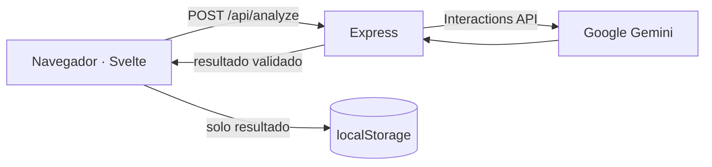
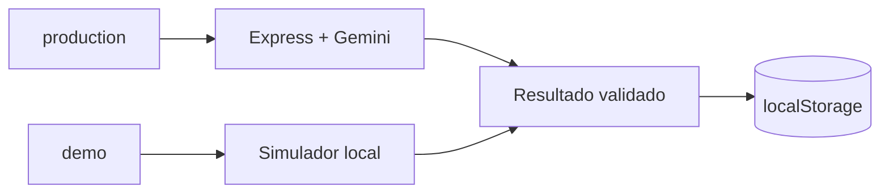

# Guía técnica de Texta

## Arquitectura



El frontend y el backend viven en el mismo repositorio. En desarrollo Vite atiende en `127.0.0.1:5173` y envía `/api` a Express en `127.0.0.1:3001`. En modo compilado Express sirve `dist/`.

El build admite dos recorridos desde el mismo código:



## Configuración

Copia `.env.example` como `.env` sin sobrescribir una configuración existente:

```dotenv
GEMINI_API_KEY=tu_key_aqui
GEMINI_MODEL=gemini-3.5-flash
PORT=3001
SITE_URL=
```

| Variable | Alcance | Predeterminado |
| --- | --- | --- |
| `GEMINI_API_KEY` | Secreto obligatorio para análisis reales; solo backend | Sin valor |
| `GEMINI_MODEL` | Modelo compatible con Interactions y JSON Schema | `gemini-3.5-flash` |
| `PORT` | Puerto del servidor compilado | `3001` |
| `SITE_URL` | Origen HTTPS público para canonical y Open Graph al compilar | Vacío |

La key se lee en `server/index.js` y se envía a Google en el header `x-goog-api-key`. Nunca debe convertirse en una variable `VITE_`.

`app.config.json` contiene la configuración pública del build:

| Campo | `main` | `demo/github-pages` |
| --- | --- | --- |
| `mode` | `production` | `demo` |
| `base` | `/` | `/AI-Text-Analyzer/` |
| `siteUrl` | vacío o definido por `SITE_URL` | `https://alfonso-13.github.io` |

No contiene secretos. `mode: demo` reemplaza la llamada a `/api/analyze` por una respuesta local simulada y cambia los avisos de la interfaz para evitar presentarla como IA real.

## Comandos

Selecciona primero la versión documentada del proyecto:

```powershell
nvm list
nvm use 24.19.0
node --version
```

El resultado debe comenzar con `v24`. Después usa el script local recomendado:

```powershell
.\run-local.ps1             # Vite + Express en desarrollo
.\run-local.ps1 -Verify     # verificación completa
.\run-local.ps1 -Production # build + servidor local de producción
```

El script valida Node 24, crea `.env` desde la plantilla cuando falta e instala dependencias si todavía no existe `node_modules`. No cambia la versión de NVM automáticamente.

Comandos npm equivalentes:

```powershell
npm run dev             # Vite + Express en desarrollo
npm run build           # compila el modo definido en app.config.json
npm start               # sirve dist y API desde Express
npm run check           # diagnósticos Svelte
npm test                # pruebas sin llamadas externas
npm run audit:secrets   # árbol, historial Git y dist
npm run verify          # check + test + build + auditoría
```

`run-local.ps1` ofrece los modos equivalentes normal, `-Production` y `-Verify`. Los procesos se enlazan únicamente a loopback.

### Demo estática de GitHub Pages

La aplicación soporta `production` y `demo` desde el mismo código. `app.config.json` selecciona el modo, la ruta base y el origen público; `main` conserva `production` como valor predeterminado. En `demo`, la llamada a Gemini se sustituye por una simulación local identificada claramente en la interfaz y el texto no sale del navegador.

La rama `demo/github-pages` cambia únicamente esa configuración a `demo` y añade `pages-demo.yml`, que valida, compila y publica `dist/`. En GitHub se debe seleccionar **GitHub Actions** como fuente de Pages; no es necesario rastrear archivos compilados ni configurar secretos.

Para revisar la publicación localmente desde esa rama:

```powershell
npm ci
npm run build
npx vite preview --host 127.0.0.1
```

La demo conserva resultados simulados en `localStorage` para que Historial y Resumen sean navegables. No guarda el texto original, no consume cuota y no debe utilizarse para evaluar la calidad de un análisis de IA.

## Contrato de análisis

`POST /api/analyze` requiere `Content-Type: application/json`:

```json
{ "text": "La nueva herramienta nos ayudó a trabajar mejor." }
```

Respuesta `200`:

```json
{
  "summary": "Una nueva herramienta mejoró el trabajo del equipo.",
  "sentiment": "positive",
  "language": "es",
  "keywords": ["herramienta", "trabajo"],
  "category": "tecnología",
  "analyzedAt": "2026-10-21T20:24:21.858Z"
}
```

Sentimientos: `positive`, `negative`, `neutral`. Categorías: `tecnología`, `deportes`, `política`, `entretenimiento`, `ciencia`, `negocios`, `otro`. `analyzedAt` es una fecha UTC asignada por el backend después de validar la salida del proveedor.

El servidor expone además `GET /api/health`. El historial y el resumen no son endpoints: se calculan en el cliente con los resultados almacenados en `localStorage`.

## Flujo de datos y privacidad

- El texto original viaja del navegador al backend y de ahí a Google Gemini.
- La solicitud usa `store: false`, pero siguen aplicando los términos y políticas de datos de Google.
- El backend no persiste el texto ni el resultado.
- El navegador guarda hasta 500 resultados validados bajo `texta.analysis-history.v1`.
- El historial no contiene el texto original, no cruza navegadores y se pierde al borrar los datos del sitio.
- Las salidas se renderizan como texto, nunca como HTML interpretado.

En modo `demo`, el texto no se envía al backend ni a Google. El navegador genera una respuesta de muestra mediante reglas sencillas y guarda únicamente ese resultado simulado en el mismo historial local.

## Resiliencia y seguridad

- Máximo de entrada: 12,000 caracteres.
- Límite local: 20 análisis por minuto por IP.
- Timeout del proveedor: 30 segundos.
- Un reintento ante `503` dentro del mismo límite de tiempo.
- Traducción de errores sin filtrar respuestas privadas del proveedor.
- Helmet, `Cache-Control: no-store` para `/api` y validación estricta con Zod.
- Auditoría propia de secretos en archivos publicables, blobs Git alcanzables y `dist`.

Estos controles son apropiados para ejecución local. Una publicación abierta requeriría autenticación o cuotas globales, presupuesto y apagado, protección antiabuso, observabilidad, política de privacidad y configuración explícita de proxy.

## Estructura

- `src/App.svelte`: enrutamiento local, layout, tema y orquestación del historial.
- `src/components/AnalyzerView.svelte`: editor, petición y presentación del resultado.
- `src/components/HistoryView.svelte`: historial local paginado en la interfaz.
- `src/components/SummaryView.svelte`: métricas derivadas del historial.
- `src/components/InfoView.svelte`: explicación visual y flujo animado del análisis.
- `src/lib/history.js`: lectura, validación, límite y resumen de `localStorage`.
- `server/`: API, errores y adaptador de Gemini.
- `shared/analysis.js`: contratos Zod del proveedor y la respuesta HTTP.
- `test/`: pruebas de API, proveedor, almacenamiento local, muestras y secretos.

## Marca y metadatos

Los tokens visuales principales son rojo `#e30613`, negro `#121212` y blanco. `src/theme.css` contiene la capa de marca y los temas. Los íconos y la tarjeta social se regeneran en Windows con:

```powershell
powershell -NoProfile -File .\scripts\generate-brand-assets.ps1
```

Configura `SITE_URL` antes del build únicamente cuando exista un dominio HTTPS real. Sin ese valor el proyecto no inventa canonical, sitemap ni URL de demo.
