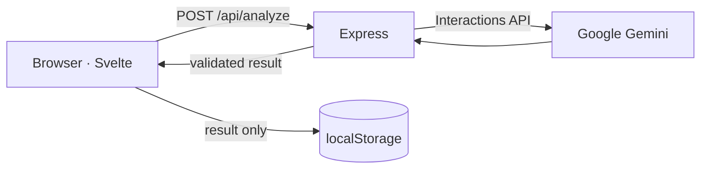
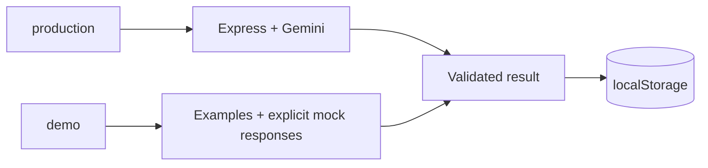

# Texta technical guide

This guide documents the architecture, configuration, commands, API contract, privacy boundaries, resilience controls, and GitHub Pages demo workflow.

<details>
<summary><strong>Resumen técnico en español</strong></summary>

Texta utiliza Svelte 5 en el frontend y Express 5 en el backend. La API valida la entrada, consulta Gemini con salida JSON estructurada y vuelve a validar el resultado antes de enviarlo al navegador. El servidor no persiste textos ni resultados; el historial y las métricas se calculan localmente con `localStorage`.

El mismo código soporta dos perfiles desde `main`: producción usa Express y Gemini, mientras que `npm run build:demo` genera una versión estática con ejemplos ficticios y respuestas mock para GitHub Pages. La rama `gh-pages` contiene únicamente el build público compilado.

</details>

## Architecture



Frontend and backend live in the same repository. During development, Vite runs on `127.0.0.1:5173` and proxies `/api` to Express on `127.0.0.1:3001`. In a compiled production build, Express serves `dist/`.

The same source supports two execution paths:



## Configuration

Copy `.env.example` to `.env` without overwriting an existing local configuration:

```dotenv
GEMINI_API_KEY=your_key_here
GEMINI_MODEL=gemini-3.5-flash
PORT=3001
SITE_URL=
```

| Variable | Scope | Default |
| --- | --- | --- |
| `GEMINI_API_KEY` | Required secret for real analysis; backend only | Empty |
| `GEMINI_MODEL` | Model compatible with Interactions and JSON Schema | `gemini-3.5-flash` |
| `PORT` | Compiled server port | `3001` |
| `SITE_URL` | Public HTTPS origin used for canonical and Open Graph metadata | Empty |

The key is read in `server/index.js` and sent to Google through the `x-goog-api-key` header. It must never be exposed through a `VITE_` variable.

`app.config.json` contains the public configuration for both profiles:

| Field | Production | Demo |
| --- | --- | --- |
| Selector | Default (`mode: production`) | `vite --mode demo` |
| `base` | `/` | `/AI-Text-Analyzer/` |
| `siteUrl` | Empty or provided through `SITE_URL` | `https://alfonso-13.github.io` |

The file contains no secrets. The `demo` profile disables free-form input, replaces `/api/analyze` with the exact mock associated with the selected example, and changes interface notices so the result is never presented as real AI output.

## Commands

Select the documented Node.js version first:

```powershell
nvm list
nvm use 24.19.0
node --version
```

The result must start with `v24`. The recommended local launcher is:

```powershell
.\run-local.ps1             # Vite + Express development
.\run-local.ps1 -Verify     # complete production verification
.\run-local.ps1 -Production # production build + local server
```

The script requires the exact documented Node.js version. On every launch, it runs `nvm use 24.19.0`, validates the executable inside that NVM installation, and invokes its own `npm.cmd` so another Node entry earlier in `PATH` cannot take precedence. It also creates `.env` from the template when missing and installs dependencies when `node_modules` does not exist. If NVM or the required version is unavailable, it stops with an installation hint.

Equivalent npm commands:

```powershell
npm run dev             # Vite + Express development
npm run build           # production build
npm run build:demo      # static demo build with mocks
npm start               # serve dist and the API through Express
npm run check           # Svelte diagnostics
npm test                # tests without external API calls
npm run audit:secrets   # scan publishable files, Git history, and dist
npm run verify          # check + tests + production build + secret audit
npm run verify:demo     # check + tests + demo build + secret audit
```

All local processes bind to loopback only.

## Interface language and entrance

The interface defaults to English and exposes an `EN / ES` selector in the header. The selection is stored under `texta.language`, updates the document `lang` attribute, and applies to navigation, dialogs, empty states, history, summary metrics, technical information, dates, sentiments, detected languages, and category labels. AI-generated summaries keep their contract-defined Spanish output.

The initial experience uses a short brand entrance inspired by the presentation patterns in the author's other portfolio projects, adapted to Texta's red, black, and white identity. It:

- runs once per browser tab session using `texta.intro-seen.v1`;
- can be replayed by adding `?intro` to the URL;
- removes itself after animation completion with a timeout fallback;
- never intercepts pointer input;
- is skipped when `prefers-reduced-motion: reduce` is active;
- staggers the top bar, navigation, content, and footer into view after the curtain exits.

The decision logic lives in `src/lib/intro.js`, browser orchestration in `src/intro.js`, markup in `index.html`, and visual treatment in `src/theme.css`.

## Static GitHub Pages demo

Production and demo live in the same source branch. `npm run build:demo` selects the public profile without modifying tracked files.

In demo mode:

- Free-form input is disabled.
- Visitors can select only fictional, predefined examples.
- Each example has one explicit, related mock response.
- A 1.4-second delay reproduces the request/loading experience.
- No heuristic analysis, backend request, Gemini call, API key, or quota is involved.
- The selected example and mock response are stored in browser-local history so History and Summary remain functional.

`npm run build:demo` generates `dist/`. Those compiled files are published at the root of the `gh-pages` branch. GitHub must remain configured as **Deploy from a branch** → `gh-pages` → `/(root)`. `gh-pages` is a deployment artifact; editable source belongs only in `main`.

Review the public build locally from `main`:

```powershell
npm ci
npm run build:demo
npx vite preview --host 127.0.0.1
```

The public demo must not be used to evaluate the quality of an AI analysis.

## Analysis API contract

`POST /api/analyze` requires `Content-Type: application/json`:

```json
{ "text": "The new tool helped the team work more efficiently." }
```

Successful `200` response:

```json
{
  "summary": "Una nueva herramienta mejoró el trabajo del equipo.",
  "sentiment": "positive",
  "language": "en",
  "keywords": ["tool", "team", "work"],
  "category": "tecnología",
  "analyzedAt": "2026-10-21T20:24:21.858Z"
}
```

Sentiments: `positive`, `negative`, `neutral`.

Categories: `tecnología`, `deportes`, `política`, `entretenimiento`, `ciencia`, `negocios`, `otro`.

`analyzedAt` is a UTC timestamp assigned by the backend after provider output validation. The server also exposes `GET /api/health`. History and Summary are not API endpoints; the browser calculates them from validated `localStorage` records.

## Data flow and privacy

### Production

- Original text travels from the browser to the backend and then to Google Gemini.
- Requests use `store: false`; Google terms and data policies still apply.
- The backend persists neither text nor results.
- The browser stores up to 500 validated results under `texta.analysis-history.v1`.
- Production history excludes original input, does not cross browsers, and disappears when site data is cleared.
- Outputs are rendered as text, never interpreted as HTML.

### Demo

- Free-form input is not accepted.
- No request is sent to the backend or Google.
- Every predefined example has an explicit mock response.
- The browser simulates the request wait and locally stores the selected example with its mock result.
- Demo-only records are identified as simulated data.

## Resilience and security

- Maximum input: 12,000 characters.
- Local rate limit: 20 analyses per minute per IP.
- Provider timeout: 30 seconds.
- One retry for `503` responses within the same timeout budget.
- Safe error translation without leaking private provider responses.
- Helmet and `Cache-Control: no-store` for `/api`.
- Strict Zod validation at input, provider output, HTTP response, and browser-storage boundaries.
- Custom secret audit across publishable files, reachable Git blobs, and `dist/`.

These controls are appropriate for local execution. A public service with real analysis would additionally require authentication or global quotas, budget monitoring and shutdown controls, abuse protection, observability, a privacy policy, and explicit proxy configuration.

## Project structure

- `src/App.svelte`: local routing, layout, theme, and history orchestration.
- `src/components/AnalyzerView.svelte`: editor, request flow, demo flow, and result presentation.
- `src/components/HistoryView.svelte`: paginated browser-local history.
- `src/components/SummaryView.svelte`: metrics derived from local history.
- `src/components/InfoView.svelte`: visual explanation and animated analysis flow.
- `src/data/sample-texts.json`: fictional examples and their explicit demo mocks.
- `src/lib/demo.js`: exact mock lookup and response validation.
- `src/lib/i18n.js`: English and Spanish UI copy, locale formatting, and display labels.
- `src/lib/intro.js`: testable entrance playback policy.
- `src/intro.js`: session storage, replay query, animation completion, and fallback cleanup.
- `src/lib/history.js`: validated `localStorage` reads, writes, and limits.
- `server/`: API, safe errors, and Gemini adapter.
- `shared/analysis.js`: shared Zod contracts.
- `test/`: API, provider, storage, demo, sample, and secret-audit tests.

## Brand and metadata

The main visual tokens are red `#e30613`, black `#121212`, and white. `src/theme.css` contains the brand and theme layers.

Regenerate icons and the social card on Windows with:

```powershell
powershell -NoProfile -File .\scripts\generate-brand-assets.ps1
```

Set `SITE_URL` before a production build only when a real public HTTPS origin exists. Without it, the project does not invent canonical, sitemap, or public demo URLs.
