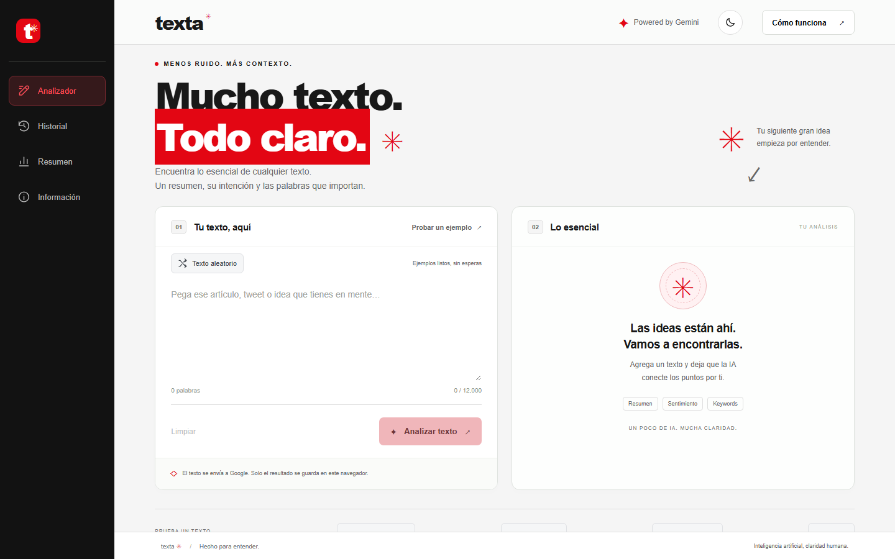
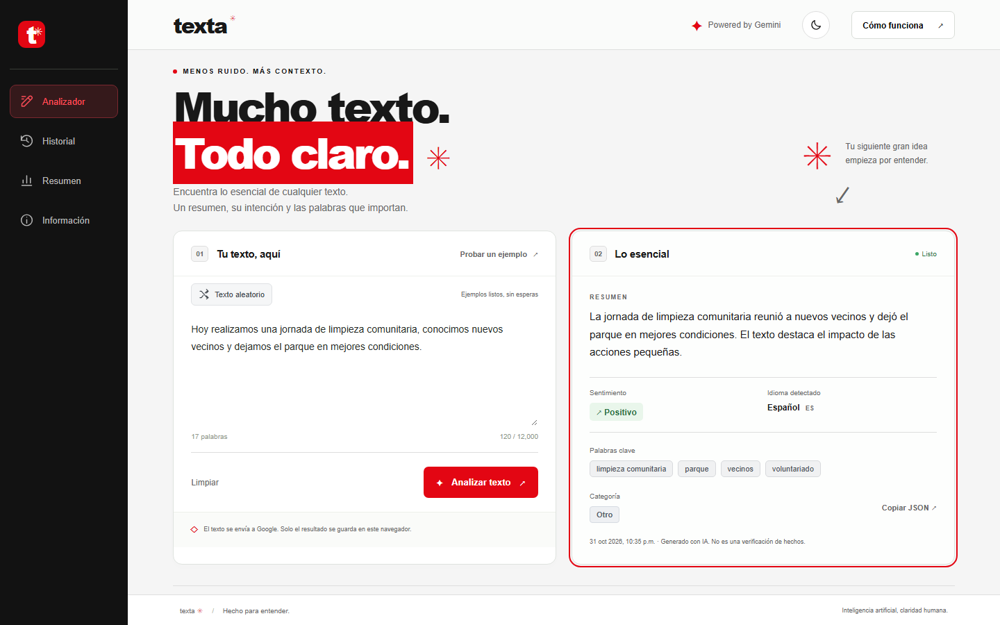
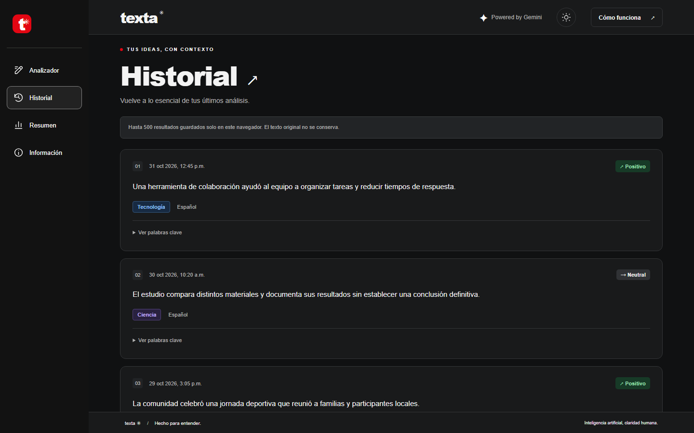
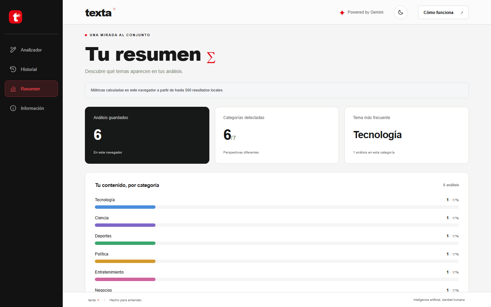
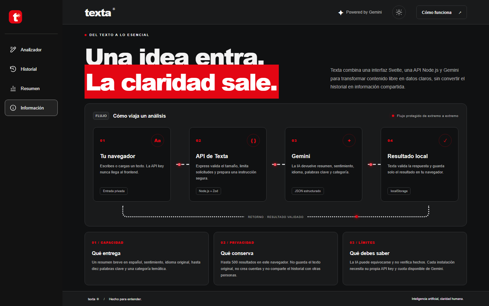
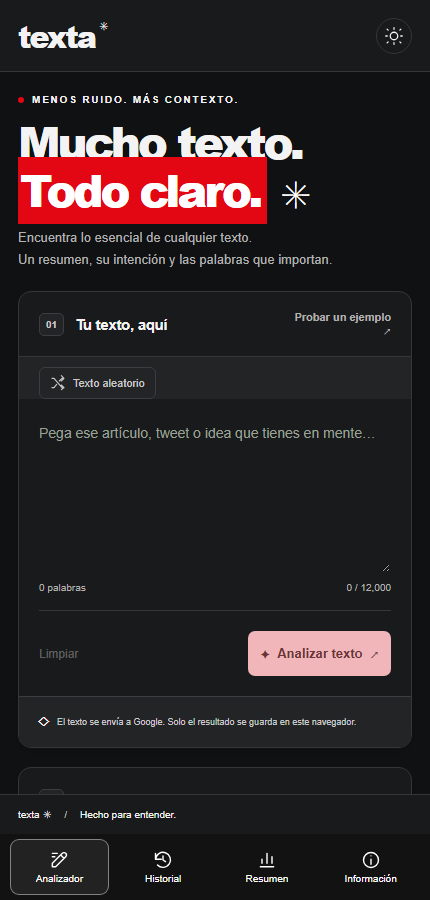

# Texta · AI Text Analyzer

Demo full-stack que convierte texto libre en un resumen en español, sentimiento, idioma, palabras clave y categoría mediante Google Gemini.

Nació como proyecto de aprendizaje y portafolio para demostrar una integración de IA útil, validada y segura: la API key permanece en el backend y el historial se conserva únicamente en el navegador.



## Qué demuestra

- Svelte 5 y una interfaz adaptable con temas claro y oscuro.
- Express 5, límites de solicitudes, timeout y manejo seguro de errores.
- Contratos Zod compartidos para validar entrada, salida del modelo y respuesta HTTP.
- Integración con Gemini usando salida JSON estructurada y `store: false`.
- Historial privado por navegador, sin almacenar el texto original en el servidor.
- Pruebas automatizadas, build y auditoría de secretos.

## Evidencia visual

| Analizador | Resultado |
| --- | --- |
|  |  |

| Historial | Resumen |
| --- | --- |
|  |  |

| Cómo funciona | Vista móvil |
| --- | --- |
|  |  |

Las capturas usan contenido ficticio. La aplicación no verifica hechos y no debe interpretarse como una fuente informativa.

## Ejecutar localmente

Requiere Node.js **24.x**, npm y una API key de Gemini:

```powershell
git clone https://github.com/Alfonso-13/AI-Text-Analyzer.git
cd AI-Text-Analyzer
nvm list
nvm use 24.19.0
npm ci
Copy-Item .env.example .env
```

Agrega `GEMINI_API_KEY` a `.env` y ejecuta:

```powershell
.\run-local.ps1
```

Abre [http://127.0.0.1:5173](http://127.0.0.1:5173). El script levanta Vite y Express; no cambia la versión de NVM automáticamente.

Para validar el proyecto completo:

```powershell
.\run-local.ps1 -Verify
```

## Alcance

Es una demo educativa y reutilizable, no un servicio público operado. Cada instalación usa su propia API key y cuota. Una publicación abierta requeriría autenticación, control de presupuesto, protección antiabuso y observabilidad.

La guía de configuración, arquitectura, contrato API, privacidad y comandos está en [DEV.md](DEV.md). Distribuido bajo [licencia MIT](LICENSE).
